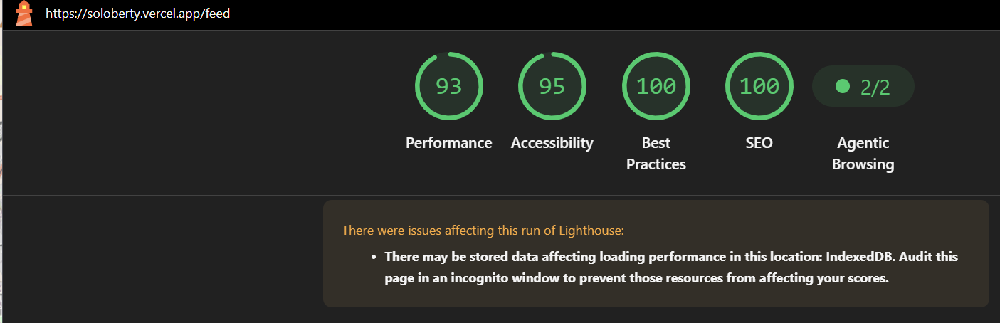
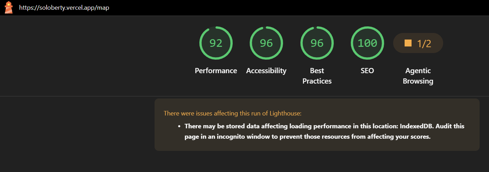
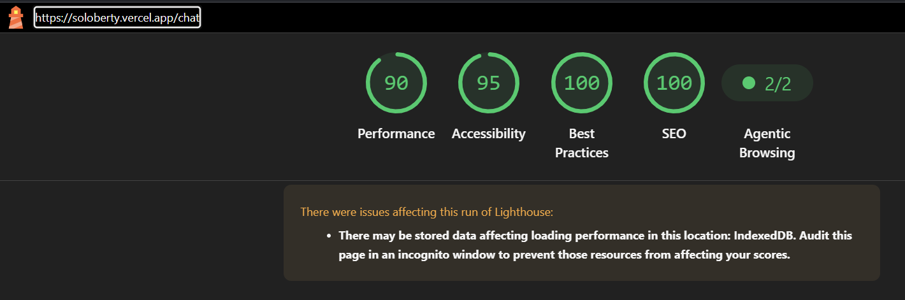
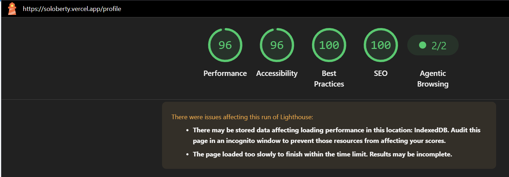

# Soloberty — AI-Native Social & Events Discovery App

**Live Production URL:** [https://soloberty.vercel.app](https://soloberty.vercel.app)

Soloberty is a full-stack, AI-native social and local-events discovery web application built with **Next.js 16 (App Router)**, **React 19**, **Tailwind CSS v4**, **Firebase (Auth, Firestore, Admin SDK, FCM)**, **Cloudinary**, **Leaflet / OpenStreetMap**, and **Google Gemini (`gemini-3.5-flash-lite`)** via the Vercel AI SDK.

---

## What It Does

* **MatchStack Feed (`/feed`)**: Swipeable/interactive member cards with 3D flip bio & interest galleries, location jump-to-map links, and AI-powered **"Why You Two?"** compatibility summaries (`/api/why-you-two`).
* **Events Discovery (`/discover`)**: Paginated (15/page) local events grid combining **Ticketmaster Discovery API** events (with a curated European/Turkish mock fallback when no key is set) and **Firestore community events**. Includes:
  * **Scout AI Event Concierge** (`/api/events/recommend`): Natural-language prompt search and one-click *"Recommend for me"* ranking based on the user's profile interests.
  * **Create / Edit / Delete Community Events** (`/api/events/community`): Custom `DateTimePicker`, live city autocomplete (`/api/location/search`), interactive Leaflet `LocationPickerMap`, and Cloudinary cover image uploads.
  * **Mandatory Host Attendance & Attendees Popover**: Paginated (5/page) floating attendees list with a unified orange **"Ask the event host"** chat button.
  * **Share Event in Chat**: Send formatted event invites directly into any friend's chat thread with **See Event** and **View on Map** action buttons.
* **Interactive Map (`/map`)**: Leaflet + OpenStreetMap canvas with a **People | Events** spring toggle, km radius distance filter, 4-tier zoom clustering (Continents → Countries → Cities → 1 km proximity clusters), paginated 2-item cluster lists, and smooth `flyTo` animations from Feed/Discover/Chat.
* **Real-Time Chat & Generative AI Icebreakers (`/chat`)**: Persistent Firestore conversations with unread badges, push notifications, and streaming `suggestIcebreakers` generative UI tool states (`partial-call` → `call` → `result` → `error`).
* **Profile & Onboarding (`/profile`, `/auth/signup`, `/auth/login`)**: Multi-step signup wizard with AI bio drafting (`/api/bio`), Cloudinary media management, dark/light theme, Dev Mode toggle, and reduced-motion support.

---

## Screenshots

| Feed (MatchStack) | Interactive Map |
| --- | --- |
|  |  |

| Real-Time Chat & AI Icebreakers | User Profile |
| --- | --- |
|  |  |

---

## Getting Started (Clone & Run Locally)

### Prerequisites
* **Node.js 20+** and **npm**
* A **Firebase** project (Auth + Firestore)
* A **Google AI Studio** API key (`GOOGLE_GENERATIVE_AI_API_KEY`)
* *(Optional)* **Cloudinary** account for image uploads and **Ticketmaster Discovery API** key for live external events

### 1. Clone & Install
```bash
git clone https://github.com/Jeeareen/soloberty.git
cd soloberty/discovery-app
npm install
```

### 2. Configure Environment Variables
Create `discovery-app/.env.local` using the table below.

### 3. Run Development Server
```bash
npm run dev
```
Open [http://localhost:3000](http://localhost:3000).

### 4. Production Build & Tests
```bash
npm run build        # TypeScript + Next.js production build
npm run start        # Serve production build locally
npm test             # Vitest unit/component tests
npm run test:e2e     # Playwright end-to-end tests
```

---

## Environment Variables

| Variable | Scope | Required | Purpose |
| --- | --- | --- | --- |
| `GOOGLE_GENERATIVE_AI_API_KEY` | Server | Yes | Powers all Gemini (`gemini-3.5-flash-lite`) routes (`/api/chat`, `/api/bio`, `/api/why-you-two`, `/api/events/recommend`). |
| `NEXT_PUBLIC_FIREBASE_API_KEY` | Client | Yes | Firebase web SDK API key. |
| `NEXT_PUBLIC_FIREBASE_AUTH_DOMAIN` | Client | Yes | Firebase Auth domain. |
| `NEXT_PUBLIC_FIREBASE_PROJECT_ID` | Client | Yes | Firebase project ID (also used for SSR Firestore REST reads). |
| `NEXT_PUBLIC_FIREBASE_STORAGE_BUCKET` | Client | Yes | Firebase storage bucket. |
| `NEXT_PUBLIC_FIREBASE_MESSAGING_SENDER_ID` | Client | Yes | Firebase Cloud Messaging sender ID. |
| `NEXT_PUBLIC_FIREBASE_APP_ID` | Client | Yes | Firebase web app ID. |
| `NEXT_PUBLIC_FIREBASE_VAPID_KEY` | Client | Optional | Web Push VAPID key for browser notifications. |
| `FIREBASE_SERVICE_ACCOUNT_KEY` | Server | Recommended | JSON stringified Firebase Admin service account; powers server-side community events CRUD/RSVP (`/api/events/community`), SSR community events, and FCM push (`/api/notifications/push`). |
| `NEXT_PUBLIC_CLOUDINARY_CLOUD_NAME` | Client | Optional | Cloudinary cloud name for profile & event cover uploads. |
| `NEXT_PUBLIC_CLOUDINARY_UPLOAD_PRESET` | Client | Optional | Unsigned upload preset for client-side Cloudinary uploads. |
| `CLOUDINARY_API_KEY` | Server | Optional | Server-side Cloudinary asset deletion (`/api/cloudinary/delete`). |
| `CLOUDINARY_API_SECRET` | Server | Optional | Server-side Cloudinary signature for asset deletion. |
| `TICKETMASTER_API_KEY` | Server | Optional | Live Ticketmaster Discovery API events (`/api/events`). If omitted, the app automatically falls back to curated mock events in `discovery-app/lib/events/mockEvents.ts`. *(Note: Production currently runs on the mock fallback because the Ticketmaster developer account application is still pending approval — "Your application for an account is currently pending approval. Once it has been approved, you will receive another email containing information about how to log in, set your password, and other details." Dropping the key into `.env.local` / Vercel activates live Ticketmaster results with zero code changes.)* |

---

## Architecture Overview

```text
discovery-app/
├── app/
│   ├── page.tsx                        # Interactive WebGL fragment shader hero & auth routing
│   ├── feed/page.tsx                   # SSR MatchStack discovery feed
│   ├── discover/page.tsx               # SSR Events Discovery page (Ticketmaster + Firestore + Scout AI)
│   ├── map/page.tsx                    # Leaflet map with People | Events toggle & zoom clustering
│   ├── chat/page.tsx                   # Conversation list & IndividualChat loader
│   ├── profile/ & auth/                # Profile editor, signup wizard, login
│   └── api/
│       ├── chat/route.ts               # Streaming Scout AI chat + suggestIcebreakers tool
│       ├── bio/route.ts                # AI first-person bio generator
│       ├── why-you-two/route.ts        # Structured-output compatibility generator
│       ├── events/route.ts             # Ticketmaster Discovery API proxy (5m cache + mock fallback)
│       ├── events/community/route.ts   # Firebase Admin CRUD, RSVP, and attendee name resolution
│       ├── events/recommend/route.ts   # Scout AI event recommender
│       ├── location/search/route.ts    # Photon/OSM city autocomplete geocoder
│       ├── cloudinary/delete/route.ts  # Signed Cloudinary asset cleanup
│       └── notifications/push/route.ts # Firebase Admin FCM web push sender
├── components/                         # Modular UI (Events/, Map/, Chat/, Profile/, Auth/)
├── lib/
│   ├── ai/rateLimit.ts                 # Shared per-IP sliding-window rate limiter for AI routes
│   ├── events/                         # Server & client event helpers + mock fallback catalog
│   ├── firebase/                       # Firebase web SDK init & storage helpers
│   ├── tools/                          # Zod schemas & execution logic for AI tools
│   └── cloudinary.ts                   # Upload & on-the-fly f_auto,q_auto,w_600 transforms
└── docs/audit/                         # Lighthouse & WAVE accessibility/performance audit reports
```

---

## AI Abuse Protection & Production Hygiene

All AI endpoints share [`discovery-app/lib/ai/rateLimit.ts`](discovery-app/lib/ai/rateLimit.ts), enforce strict input length caps, and set `export const maxDuration = 30` for serverless stability:

| Endpoint | Rate Limit (per IP) | Input Caps | `maxDuration` |
| --- | --- | --- | --- |
| `POST /api/chat` | 20 req / min | Max 20 messages, 1,500 chars/msg, 8,000 total chars | `30s` |
| `POST /api/bio` | 10 req / min | `name` ≤ 60 chars, `interests` ≤ 250 chars | `30s` |
| `POST /api/why-you-two` | 15 req / min | `bio` ≤ 500 chars, ≤ 15 interests (40 chars each) | `30s` |
| `POST /api/events/recommend` | 15 req / min | `prompt` ≤ 300 chars, ≤ 25 catalog events, ≤ 12 interests | `30s` |

Exceeding a limit returns HTTP `429 Too Many Requests` with a `Retry-After` header.

---

## Key Engineering Decisions

* **SSR Community Events + No `useSearchParams` Suspense Bailout**: Initially, wrapping `/discover` in `<Suspense fallback={null}>` with `useSearchParams()` caused Next.js to emit empty HTML on static prerender (6.1s LCP, 0.204 CLS). Moving query-param reading to `useEffect` and fetching initial community events server-side via Firebase Admin (`revalidate = 60`) eliminated the post-hydration prepend shift and made the LCP cover image immediately discoverable in HTML.
* **Server-Side Community Events via Firebase Admin**: Routing community event creation, edits, deletion, and RSVPs through `/api/events/community` keeps Firestore client rules strict while enforcing `hostId` ownership checks, mandatory creator attendance, and single-round-trip `db.getAll()` attendee name resolution.
* **Lazy-Loaded Heavy Modals**: `CreateEventModal` (Leaflet map picker + Cloudinary) and `ShareEventModal` (Firestore conversations) are dynamically imported with `ssr: false` and mounted only when opened, keeping ~197 KiB of unused JS off the initial `/discover` load.
* **Cross-Browser 3D Card Flips (Safari/WebKit)**: Added Safari-only symmetric midpoint visibility/opacity transitions and moved border/radius styling onto individual card faces so 3D `rotateY(180deg)` flips never mirror or bleed through in WebKit while staying untouched in Chrome and Firefox.
* **4-Tier Map Clustering Without External Cluster Plugins**: Implemented deterministic Continent → Country → City → 1 km proximity clustering directly on Leaflet `LayerGroup` for both People and Events, paired with a full-bleed frosted map preview backdrop for fast LCP.

---

## How AI Tools Built This

This project was built with **Antigravity (Google DeepMind's agentic coding assistant)** alongside **Google Gemini (`gemini-3.5-flash-lite`)** inside the product itself. Here is an honest breakdown of what AI accelerated vs. where manual engineering and judgment were essential:

* **Where AI accelerated delivery**:
  * Scaffolding full-stack slices quickly (Next.js App Router handlers, TypeScript interfaces, Zod tool schemas, and Tailwind v4 responsive layouts).
  * Parsing large Lighthouse JSON reports (`discovery-app/docs/audit/discover-lh.json`) to isolate exact LCP subpart delays (`resourceLoadDelay: 2846ms`) and CLS culprit DOM nodes (`page-1-ARTICLE`).
  * Implementing repetitive UI polish (custom `DateTimePicker` popover, pagination controls, spring `layoutId` pills, dark-mode contrast fixes).
* **Where human review & debugging were critical**:
  * **Product & routing boundaries**: Catching when an early iteration replaced `/feed` instead of `/discover`, and steering the exact UX for mobile layouts, cluster list pagination (2/page), and floating popovers so cards wouldn't shift the grid.
  * **Runtime & cross-browser edge cases**: Diagnosing Firebase client permission blocks (pivoting to Firebase Admin routes), fixing a React 19 StrictMode Leaflet `_leaflet_pos` unmount race on `flyTo`, catching Safari/WebKit 3D `preserve-3d` card mirroring via Playwright WebKit, and switching `next build` to `--webpack` to bypass a Next.js 16.2 Turbopack `next/font/google` bug on Vercel.
  * **Verification**: Running live cross-browser checks across Chrome, Firefox, and Safari/WebKit, inspecting actual Vercel production Lighthouse scores, and validating every interactive flow end-to-end rather than trusting "it compiled" as done.
